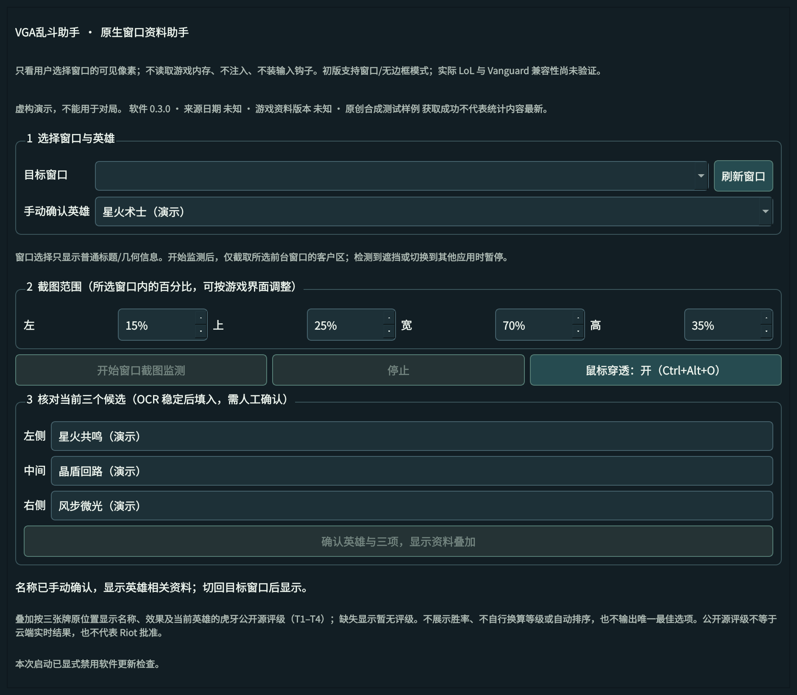
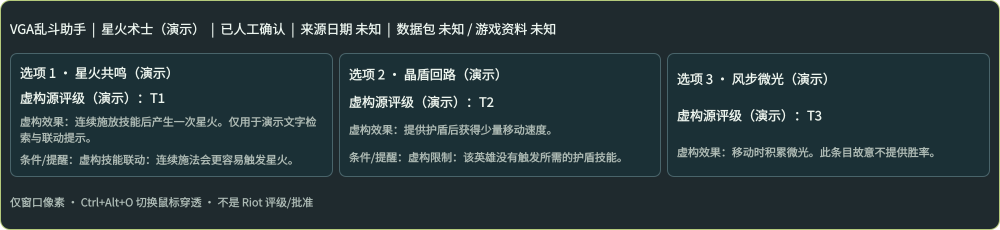

<!-- project-header:start -->
<p align="center"><a href="README.md">简体中文</a> | <a href="README.en.md">English</a></p>
<p align="center">
  
</p>
<h1 align="center">VGA乱斗助手</h1>
<p align="center"><strong>Champion-specific augment choices · Local screenshot OCR · Public data reference</strong></p>
<p align="center">
  <a href="https://github.com/Junming-Liang/vga-aram-helper/actions/workflows/build-native-preview.yml"></a>
  <a href="LICENSE"></a>
  <a href="app_version.py"></a>
  <a href="https://github.com/Junming-Liang/vga-aram-helper/releases/tag/v0.3.0"></a>
</p>
<p align="center">
  <a href="#quick-start">Quick start</a> ·
  <a href="WINDOWS_EXECUTABLE.md">Windows guide</a> ·
  <a href="DATA.md">Recommendations and statistics</a> ·
  <a href="CONTRIBUTING.md">Contributing</a> ·
  <a href="https://github.com/Junming-Liang/vga-aram-helper/issues">Report an issue</a>
</p>
<!-- project-header:end -->

A native Windows control panel and game overlay for champion-specific augment tiers, effects, and condition notes. Local OCR identifies the three choices; review them to display reference cards over the selected window.

## Features

- **Champion-specific tiers**: displays Huya's public-source T1–T4 tiers in the original three-choice order. Missing data is labeled “暂无评级” (no rating available).
- **Local OCR**: recognizes augment names with manual correction and three-choice confirmation.
- **Transparent overlay**: always-on-top reference cards with mouse click-through, toggled by `Ctrl+Alt+O`.
- **Data refresh and cache**: checks public data at startup and uses validated cached data offline.
- **Software updates**: checks stable GitHub Releases, then downloads, verifies, and installs after confirmation.

## Interface preview

The actual v0.3.0 Qt interface, rendered with original synthetic data on Linux offscreen. These are interface demonstrations, not live-game screenshots; Windows appearance may differ slightly.



*Control panel: champion and candidate review. Window capture is inactive in this demonstration environment.*



*Tier overlay: ratings, effects, and condition notes for three choices.*

## Quick start

### Windows

1. Download the [v0.3.0 Windows x64 EXE](https://github.com/Junming-Liang/vga-aram-helper/releases/download/v0.3.0/vga-aram-helper-0.3.0-windows-x64.exe) and check its [SHA-256](https://github.com/Junming-Liang/vga-aram-helper/releases/download/v0.3.0/SHA256SUMS.txt).
2. Place the EXE in a writable folder and double-click it.
3. Select the target window and champion, start monitoring, then review and confirm the three choices.

The single-file EXE includes QtWidgets, the OCR runtime, and models. See the [Windows guide](WINDOWS_EXECUTABLE.md) for setup and [License](#license) below for applicable terms. The [Release page](https://github.com/Junming-Liang/vga-aram-helper/releases/tag/v0.3.0) includes test evidence and corresponding source.

Download the current preview manually. See [UPDATES.md](UPDATES.md) for the stable-release update mechanism.

### Run from source

Use Python 3.12 x64 and run these commands in a virtual environment inside the project directory:

```sh
python -m pip install --index-url https://pypi.org/simple --only-binary=:all: -r requirements-build.txt
python launcher.py
```

`python launcher.py --demo` loads synthetic demonstration data. See [CONTRIBUTING.md](CONTRIBUTING.md) for development setup and test commands.

## Usage

- Select the champion manually, start monitoring, and switch back to the target window.
- Review the left, middle, and right names identified by OCR. Correct them if needed, then confirm.
- Confirm again after changing the champion or choices. Switching away, minimizing, scene changes, or capture failures hide the previous cards.
- Toggle mouse click-through with `Ctrl+Alt+O`. Stop monitoring or close the main window to end capture.

## Data and privacy

Reference data comes from [Huya's official public wiki](https://gametool.huya.com/league-of-legends/wiki/index.html?embed=1). Tiers use the selected champion's original records. Cards identify the source date, data-package version, and game-data version. The source date and retrieval time are recorded separately to help assess freshness. See [DATA.md](DATA.md) for formats and fields.

Capture is limited to visible client-area pixels of the selected foreground window; game process memory is not read. Normal monitoring screenshots stay in local memory and are neither saved nor uploaded. Explicit synthetic diagnostics can save test images. Network requests support public-data refresh and software updates.

## Preview and compatibility

v0.3.0 targets Windows 10/11 x64 in windowed and borderless modes. Current validation uses original synthetic mock windows on Windows Server 2022:

- [Native EXE tests](https://github.com/Junming-Liang/vga-aram-helper/actions/runs/38235785410): window capture, OCR, tier rendering, mouse click-through, and process lifecycle.
- [Updater transaction tests](https://github.com/Junming-Liang/vga-aram-helper/actions/runs/38239627458): local replacement of the same EXE, health checks, concurrency locking, and failure rollback.

Real LoL/Vanguard, exclusive fullscreen, and clean Windows 10/11 environments remain unverified. Cross-version online upgrades and the in-app confirmation handoff also await testing. Public-snapshot tiers may differ from Huya's private live model; the rating methodology and applicable game policies are not fully verified, and this project has no Riot/Tencent approval. See [WINDOWS_TESTING.md](WINDOWS_TESTING.md) for detailed scope.

The EXE is not Authenticode-signed, so Windows may show an unknown-publisher warning. Verify the file hash and keep system security protections enabled.

## Development and contributing

Report problems through [Issues](https://github.com/Junming-Liang/vga-aram-helper/issues), or contribute improvements.

- [Development environment and tests](CONTRIBUTING.md)
- [Windows builds](WINDOWS_EXECUTABLE.md)
- [Data sources](SOURCE_NOTES.md) and [validation records](reports/VALIDATION.md)

## License

Original code, icons, and synthetic test data use the [MIT License](LICENSE). Qt/PySide/Shiboken use the applicable LGPLv3 option; OCR dependencies, models, and other third-party components retain their own licenses. The Release includes complete licenses, corresponding Qt source, and application source from the same commit. See [Third-party notices](THIRD_PARTY_NOTICES.md). Third-party game data is outside this project's MIT license.

Before use, read and agree to the Microsoft runtime terms in the [Release license package](https://github.com/Junming-Liang/vga-aram-helper/releases/download/v0.3.0/third-party-licenses.zip). These terms apply only to the listed Microsoft DLLs, without restricting the MIT application source or Qt LGPL rights.

This is an independent implementation with no official affiliation with Riot Games, League of Legends, or Huya.
